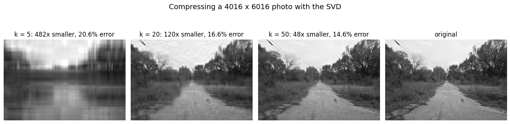
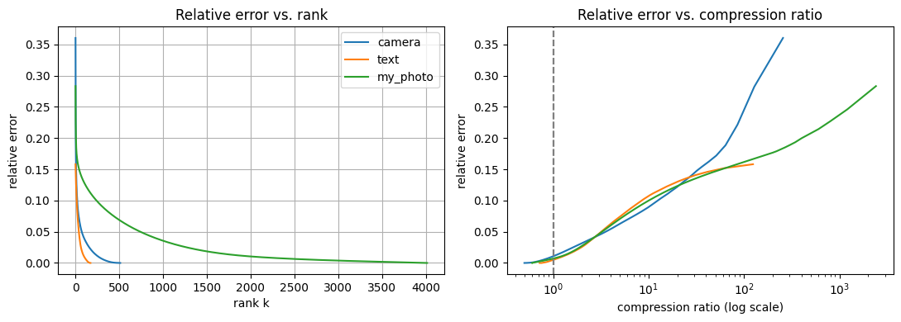
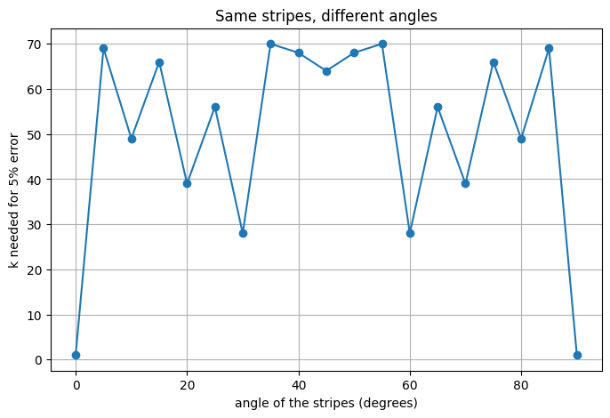

# How Much of a Photo Can You Throw Away?

**A 4016 x 6016 photo can be compressed to an arbitrary amount,
however, artifacts from compression are easily notable at k=20 and slightly noticeable at k=50. 
This is not the most surprising as we are taking an extremely large image and shoving it into a box
48x smaller, especially one which depicts nature and thus has a lot of noise inherent to it.**
## The question
Using linear algebra decomposition techniques can you compress an image? If so, to what extent can the image be compressed and still resemble itself, and what limitations might be imposed by this method.
## The idea
A grayscale image is a matrix of brightness values. The singular
value decomposition (SVD) writes any matrix as a sum of simple
rank-one pieces, ordered from most to least important:
$$A = \sigma_1 u_1 v_1^T + \sigma_2 u_2 v_2^T + \cdots$$
Keeping only the first k pieces needs k(m + n + 1) numbers
instead of mn. The Eckart-Young theorem says no other choice of
k pieces gives a smaller error.
## Results
1. **[Storage vs. quality.]** All images have under 10% error at a roughly 10x compression ratio, and anything past the dotted line uses more values than the uncompressed image. Additionally note that even though the photo I'm using is nearly 10x larger than the reference photos, it still manages to achieve the same error and compression indicating the broad use of the method.

2. **[Which images the SVD likes.]** SVD overwhelmingly likes images that are already low rank, images that approach full rank are not going to be smaller when SVD is applied. This can be seen as the K for 5% error can be 1 when the stripes are horizontal but nearly 70 when they are diagonal across the image.

## Limitations
- As is apparent in the shown images the visual change in an image can be vastly different that the supposed error.
## How to run it
Open any notebook in `notebooks/`, click "Open in Colab", then
Runtime -> Run all. Our functions are in `src/compress.py`.
## Data and references
- Test images: scikit-image (`skimage.data`), BSD license.
- `data/TZB_7471.JPG`: taken by Thaddeus Booraem, Date unknown.
- C. Eckart and G. Young (1936), The approximation of one matrix
by another of lower rank, Psychometrika 1, 211-218.
## Use of AI tools
I used the Gemini 3.5 Flash to assist in writing code for the exercises, to help me understand what the code supplied did, understand the instructions provided by the TA, and to double check my work for accuracy.
## About
Thaddeus Z. Booraem, MATH 344L, University of South Carolina, Fall 2026.
